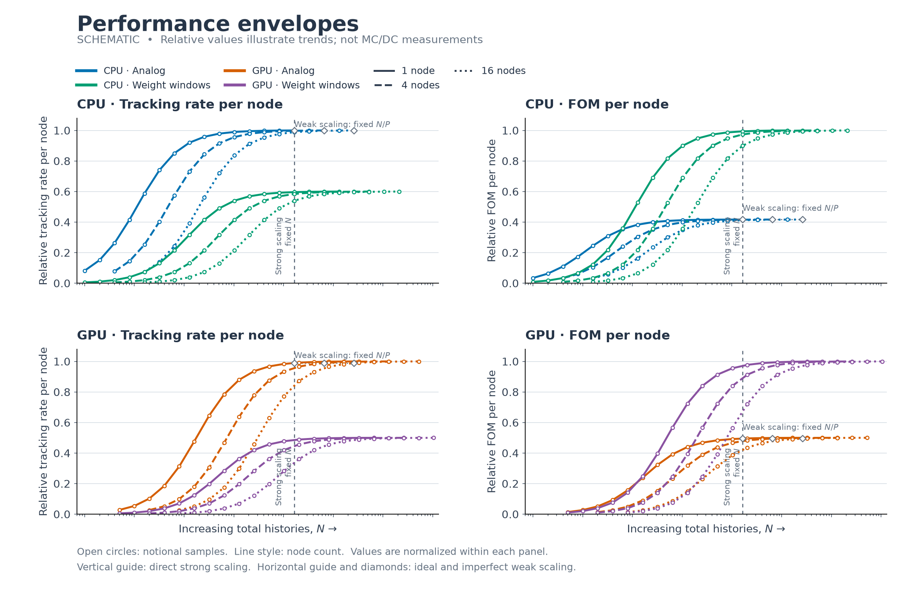
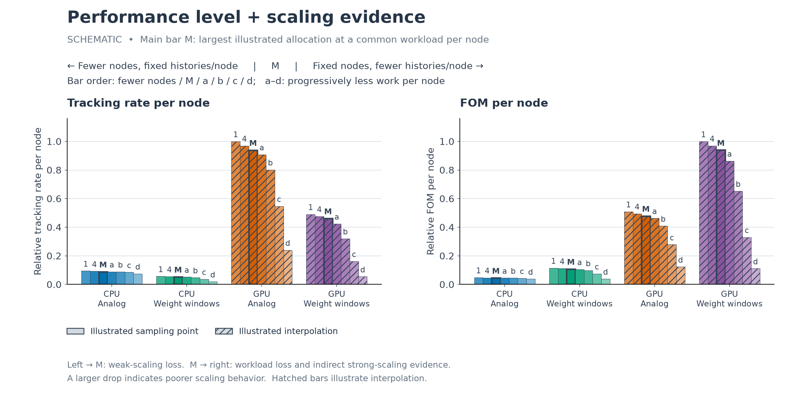

.. _project_vvp_performance:

===========
Performance
===========

Performance studies characterize computational efficiency separately from
numerical correctness and physical fidelity.
The suites measure total runtime and statistical efficiency over a range of
workloads, execution modes, platforms, and node counts.
Full tally output and compilation are part of the measured workload.

Choose a study
--------------

- :doc:`Serial performance <serial>` compares Python and Numba execution with
  one process per job, locally or on one exclusive cluster node.
- :doc:`Parallel performance <parallel>` compares full-node Numba CPU/GPU runs
  across a node-count/workload matrix and combines platform and transport-method
  results into performance envelopes and scaling summaries.

Both suites use the transient Kobayashi dog-leg detector problem, with a fuel
cube and a time-dependent capture tally at the channel exit.
The :doc:`case description <../verification/code_to_code/multigroup/fixed_source/kobayashi_detector>`
defines the observable and physical model.
Keep the physical problem, tally definitions, normalization, and batch count
consistent when comparing transport methods or platforms.
See :doc:`../campaigns/setup` for common environment and platform configuration.

Metrics and fixed reference
---------------------------

Let :math:`N` be the measured total history count, :math:`T` the total MC/DC runtime
in seconds, and :math:`P` the allocated node count.
Processors read :math:`N` and :math:`T` from ``performance/N_history`` and
``performance/runtime`` rather than inferring work from particle-count filenames.

Within a comparison, one largest-history result supplies fixed reference tally
means :math:`\mu_{i,\mathrm{ref}}`.
For each run, its tally standard errors :math:`s_i` give the maximum fractional
relative variance:

.. math::

   V = \max_{i:\mu_{i,\mathrm{ref}}\ne 0}
       \left(\frac{s_i}{\mu_{i,\mathrm{ref}}}\right)^2,
   \qquad V_{\%}=10^4 V.

The maximum includes all scores and bins with nonzero reference means, even when
a current run's mean is zero.
This is variance normalized by a fixed reference, not the squared discrepancy
between current and reference means.
The shared ``performance/metrics.py`` validates tally scores, shapes, and grids.

.. list-table::
   :header-rows: 1
   :widths: 25 35 40

   * - Metric
     - Definition
     - Unit
   * - Tracking rate
     - :math:`R=N/T`
     - Histories per second
   * - Precision
     - :math:`Q=1/V_{\%}`
     - :math:`\%^{-2}`
   * - Precision rate
     - :math:`q=Q/N`
     - :math:`\%^{-2}` per history
   * - Figure of merit (FOM)
     - :math:`F=Q/T=Rq`
     - :math:`\%^{-2}` per second

Parallel plots report tracking rate and FOM **per node**, :math:`N/(PT)` and
:math:`Q/(PT)`. Precision and precision rate are not divided by node count.
FOM combines timing and statistical efficiency; it is not a pure measure of
parallel-scaling efficiency.

Serial processing selects the largest-history output across configured modes
and prefers Numba on a tie.
Parallel processing selects across platforms and methods within a comparison,
preferring fewer nodes on ties, followed by deterministic platform/method/case
ordering.
The chosen reference, history count, contributing-bin count, and source paths
are recorded with the processed measurements.

Unavailable measurements and comparability
------------------------------------------

When no reference bin has a nonzero mean, or the maximum relative variance is
nonfinite or nonpositive, precision-derived metrics are unavailable rather than
infinite. They are recorded as ``nan`` and omitted from plotted curves; a plot
with no finite positive values explains the absence of a curve.
Timing measurements can remain usable when precision is unavailable.

No compilation-time or overhead subtraction is applied.
Numba caching is disabled in these suites so its compilation cost is included.
Runs without full tally results are rejected: older timings that omitted tally
output describe a different workload and should not be mixed into the same
performance comparison.

Reading scaling evidence
------------------------

The parallel envelope plots tracking rate and FOM per node against total
histories. It retains every measured point, exposing startup overhead, workload
saturation, and separation between node-count curves.
A vertical slice at fixed total histories compares strong scaling.
At fixed histories per node, constant per-node performance indicates ideal weak
scaling; a downward departure indicates reduced weak-scaling efficiency.

The companion summary uses a common histories-per-node workload for its main bar
and smaller-node left wing, then reduces work per node at fixed nodes on its
right wing. The left wing is direct weak-scaling evidence; the right wing shows
workload sensitivity and provides indirect strong-scaling evidence.
It does not measure the additional communication costs caused by increasing
node count at fixed total histories.
See :doc:`parallel` for workload selection, interpolation, and unavailable bars.

Illustrative envelopes and summaries
------------------------------------

These schematic figures show the intended interpretation of the plots.
Their values are synthetic, not simulation measurements or predictions for any
platform or transport method.

   Notional performance envelopes illustrating workload saturation and
   differences among node-count curves.

   Notional performance-level and scaling-evidence summary at common
   histories-per-node workloads.

A drop from the left wing toward the main bar indicates reduced weak-scaling
efficiency. A drop from the main bar toward the right indicates sensitivity to
smaller workloads and warns of reduced strong-scaling efficiency.
Inspect the envelope to determine whether the selected workload approaches a
plateau; the summary alone does not establish asymptotic performance.

.. toctree::
   :maxdepth: 1

   serial
   parallel
